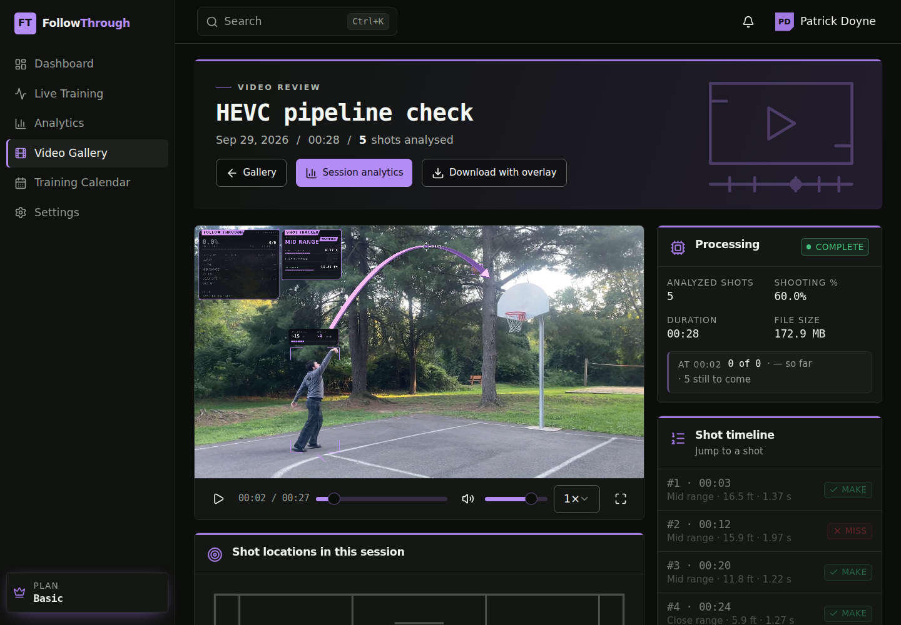

# FollowThrough

Basketball training analytics. Record a shooting session live or upload a
clip, and a computer-vision pipeline finds the ball, the shooter, the rim and
the court, decides every make and miss, and draws the analysis over the
footage in the browser: running score, shot chart, release position, flight
time and time to apex.

> **Status: V1, local development build (September 2026).** Both pipelines,
> live and upload, work end to end on one machine with a CUDA GPU. Cloud
> deployment (S3, ECS, Kinesis Video Streams signaling) is designed but not
> started; the open work is listed in [BACKLOG.md](BACKLOG.md).

**Want to see it run?** [WALKTHROUGH.md](WALKTHROUGH.md) takes a fresh
clone to a processed video in about half an hour, with no GPU required.



## What it does

| Live session | Uploaded video |
| --- | --- |
| Browser camera → WebRTC → C++ TensorRT backend | File → Spring Boot → C++ detection and FFmpeg playback preparation, run concurrently |
| Per-frame telemetry returned on a DataChannel; the overlay is drawn in the browser as it happens | Telemetry stored per video; the overlay is drawn at playback from it, in the viewer's theme, and the upload is never modified |
| The recording is captured with the overlay and saved to the session | A 28 s 4K60 HEVC clip goes from upload to playable, analysed video in 24 s on an RTX 3090 |

Measured on the reference clip (28 s, 3840×2160, 60 fps, 1,674 frames):
the GPU detection pipeline runs at about 100 fps of pipeline compute
(18.5 s wall), the CPU tier on ONNX Runtime at about 23 fps (66.8 s), and
both find the same five shots with the same results. The web app has 671
unit tests and the API 193.

## How it fits together

```
                 ┌──────────────── live ────────────────┐   ┌──────────── upload ────────────┐
browser camera ──► WebRTC ──► follow_through_webrtc (C++) │   │ browser ──PUT──► Spring Boot API │
      ▲            (relay:    TensorRT detection,         │   │                    │  @Async      │
      │         js/mock-websocket.js)  shot state machine  │   │   follow_through_batch_gpu (C++) │
      │                    │ telemetry per frame          │   │   + prepare-playback.ts (Node)   │
      └──── DataChannel ◄──┘                              │   │        telemetry → H2, files → disk
   overlay drawn on a canvas; recording uploaded          │   │   playback: overlay drawn from     │
   to the session when it ends                            │   │   the stored telemetry             │
                 └───────────────────────────────────────┘   └────────────────────────────────┘
```

One shared overlay renderer (`follow-through-pro-19/src/lib/overlay-renderer.ts`)
draws both surfaces; one C++ detection pipeline (two sources kept in step)
feeds both; one REST API owns sessions, videos, telemetry and analytics.
[ARCHITECTURE.md](ARCHITECTURE.md) has the full picture, including the
telemetry schema and the AWS seams.

## Repository layout

| Directory | What it is |
| --- | --- |
| `follow-through-pro-19/` | Web app: React 19, TypeScript, TanStack Start/Query, Tailwind, Recharts; the overlay renderer; the playback-preparation script |
| `springboot/` | REST API: Java 17, Spring Boot, Spring Data JPA, Spring Security (JWT), H2 on disk locally; the upload-processing service |
| `cpp/` | Detection pipeline: `follow-through-webrtc.cpp` (live, KVS WebRTC C SDK) and `follow-through-batch.cpp` (offline; TensorRT and ONNX Runtime targets) |
| `python/` | Model training and export (Ultralytics YOLO, TensorRT); the models the C++ loads |
| `js/` | The local WebRTC signaling relay |
| `scripts/` | `fetch-demo-assets.sh`, which downloads the sample clip, models and ONNX Runtime |
| `docs/` | Dated design decisions and the screenshots used in these documents |

## Running it locally

Full instructions, readiness checks and known quirks are in
[LOCAL_DEV.md](LOCAL_DEV.md). The short version, four processes:

```bash
# 1. signaling relay                      2. live detection backend (from cpp/build, after building)
cd js && npm install && node mock-websocket.js    cd cpp/build && ./follow_through_webrtc

# 3. web app (http://localhost:8081)      4. API (http://localhost:8082/api/v1)
cd follow-through-pro-19 && npm install && npm run dev
cd springboot && export FOLLOWTHROUGH_JWT_SECRET="$(openssl rand -base64 48)" \
  && ./mvnw spring-boot:run -Dspring-boot.run.jvmArguments="-Dfollowthrough.processing.engine=cpp"
```

Sign in with the seeded demo account `patrick.doyne@followthrough.app` /
`followthrough-dev`. The API and web app run without the GPU pieces (uploads
then use a stub processor); the live page and real processing need the C++
binaries, which need CUDA, TensorRT and the trained models
([cpp/README.md](cpp/README.md), [python/README.md](python/README.md)).

## Documentation

- [WALKTHROUGH.md](WALKTHROUGH.md): from a fresh clone to a processed video, step by step.
- [ARCHITECTURE.md](ARCHITECTURE.md): what is built and how it fits together.
- [LOCAL_DEV.md](LOCAL_DEV.md): running, testing and troubleshooting the stack.
- [BACKLOG.md](BACKLOG.md): open work, known bugs and the standing architecture decisions for the AWS version.
- [cpp/README.md](cpp/README.md): the C++ toolchain, build, telemetry contract and gotchas.
- [python/README.md](python/README.md): the Python environment, training and TensorRT export.
- [follow-through-pro-19/README.md](follow-through-pro-19/README.md): the web app.
- [docs/decisions/](docs/decisions/): dated design decisions.

## What is not in the repository

Footage, datasets, model weights and exported engines (tens of gigabytes),
the ONNX Runtime download, build output, and the local database and video
storage are ignored (`.gitignore`). The sample clip, the ONNX model exports
and the PyTorch weights are attached to the `v1-local` GitHub release;
`./scripts/fetch-demo-assets.sh` downloads them (and ONNX Runtime) into the
paths the pipeline expects. `python/README.md` explains how the models are
trained and exported, and `cpp/README.md` where the binaries look for
them.

## Origin

The web app was scaffolded with Lovable; everything since, across all three
languages, was built here with AI-assisted development (Claude Code) under
specification, review and measurement-gated acceptance.
