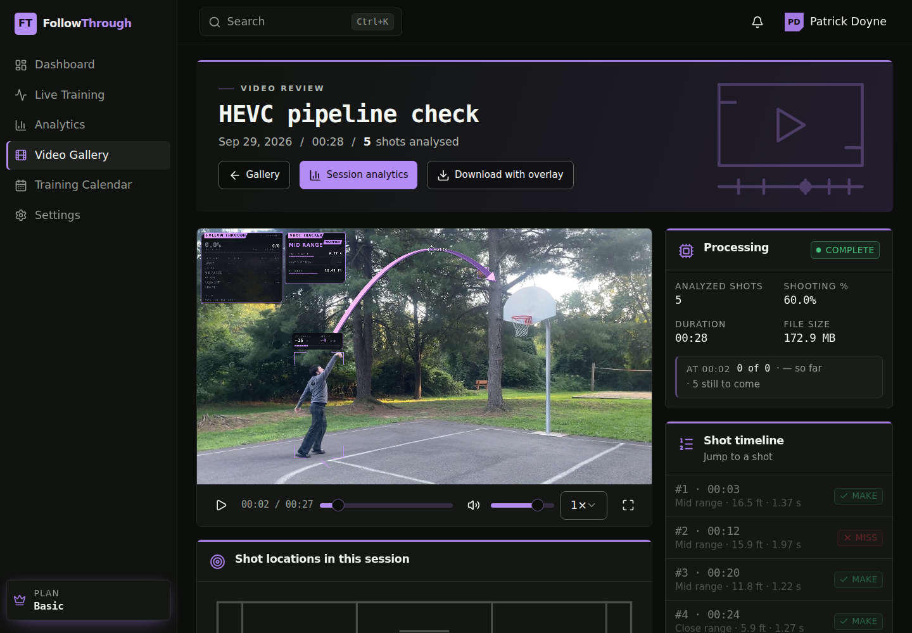
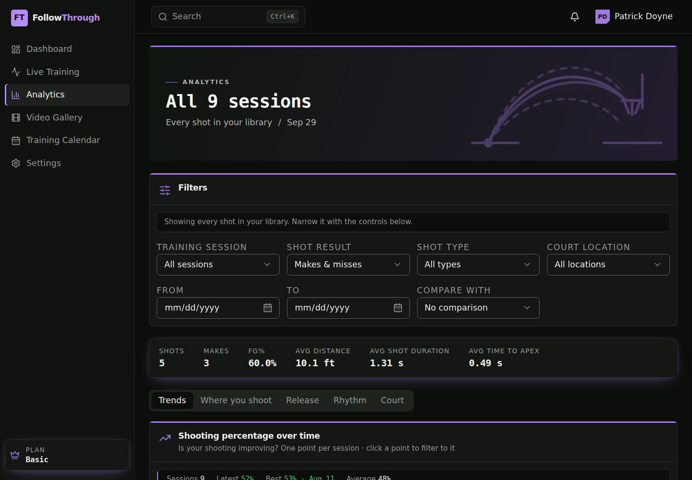

# See the pipeline run

A guided run from a fresh clone to a processed video: start the stack,
create an account, upload the sample clip, and watch the detection pipeline
find every shot in it. No GPU is needed; the walkthrough uses the CPU
detector. Budget about half an hour for setup on a fast connection, then
about two minutes per video.

What you will end up with: the 28-second sample clip analysed into five
shots (three makes, two misses), a shot chart of where they were taken
from, and the analysis overlay drawn over the footage as it plays.



## 1. What you need

- Linux x86-64 (Ubuntu 22.04 or later, or WSL2 on Windows), about 2 GB of
  free disk for downloads and dependencies, and a browser on the same
  machine.
- **Java 17** (`java -version`), **Node 22 or later** (`node --version`),
  **Git**, **curl**.
- A C++ toolchain and OpenCV for the detector:

  ```bash
  sudo apt update
  sudo apt install build-essential cmake libopencv-dev nlohmann-json3-dev
  ```

The web app and the API run without any of the C++ pieces, but then
uploads are handled by a stub that invents numbers and produces no overlay.
The point of this walkthrough is the real thing, so the detector comes
first.

## 2. Get the sample clip and the models

Footage and model weights are too large for git, so they are attached to
the repository's GitHub release. One script fetches everything into the
paths the pipeline expects (all of them git-ignored):

```bash
git clone <this repository> followthrough && cd followthrough
./scripts/fetch-demo-assets.sh
```

That downloads `burkelake8.MOV` (165 MB, a 28 s 4K60 clip shot on a
phone), the three ONNX model exports (about 100 MB: the ball/player/rim
detector, the court-keypoint model and the pose model) and ONNX Runtime
1.30.0 (30 MB, from Microsoft's releases).

## 3. Build and test the CPU detector

```bash
cmake -S cpp -B cpp/build
cmake --build cpp/build --target follow_through_batch_cpu -j"$(nproc)"
```

Only that one target is needed; the two GPU targets in the same
`CMakeLists.txt` are left unbuilt. Then run the detector on the clip
directly, before involving anything else:

```bash
cd cpp/build
./follow_through_batch_cpu ../../python/videos/train3/burkelake8.MOV /tmp/telemetry.jsonl
cd ../..
```

It prints a line per model as it loads, then the shots as it decides them:

```
+++ MAKE (frame 201)  total: 1-0 +++
--- MISS (frame 741)  total: 1-1 ---
+++ MAKE (frame 1233)  total: 2-1 +++
+++ MAKE (frame 1470)  total: 3-1 +++
--- MISS (frame 1575)  total: 3-2 ---
```

and `[PERF]` lines with the per-stage cost. On a 32-core machine the whole
clip takes about 67 s; on a laptop expect a few minutes. If this works, the
hard part is over.

## 4. Start the API

```bash
cd springboot
export FOLLOWTHROUGH_JWT_SECRET="$(openssl rand -base64 48)"
./mvnw spring-boot:run -Dspring-boot.run.jvmArguments="-Dfollowthrough.processing.engine=cpp -Dfollowthrough.cpp.binary-path=../cpp/build/follow_through_batch_cpu"
```

The first run downloads Maven and the dependencies. Ready when it prints
`Started FollowthroughApiApplication`; check with
`curl http://localhost:8082/api/v1/actuator/health`.

- `engine=cpp` turns on real processing; `binary-path` points it at the
  CPU detector you just built (the default is the GPU one).
- The JWT secret has no default on purpose: the API refuses to start
  without one, and existing sign-ins stop working if it changes, so keep
  the same value for the whole session.
- Uploads, thumbnails and the database land in `springboot/local-data/`
  and `springboot/local-video-storage/`; delete both to start over.

## 5. Start the web app

In a second terminal:

```bash
cd follow-through-pro-19
npm install
npm run dev
```

Open **http://localhost:8081**. (The port is pinned because the API only
allows that origin.)

## 6. Create your account

Click **Create one** on the sign-in page, or open
http://localhost:8081/register. Enter a full name, an email address and a
password of at least eight characters, then **Create account**. You land on
an empty dashboard signed in as that account; every session and video you
see from now on is yours alone.

(A seeded demo account also exists, `patrick.doyne@followthrough.app` /
`followthrough-dev`, with sample sessions whose charts are populated but
whose videos are placeholders. It is useful for looking at the analytics
screens, but use your own account for the upload so the result is
unmistakably from the pipeline.)

## 7. Upload the clip

1. Open **Video Gallery** in the sidebar and click **Upload video**.
2. In *Upload a recorded video*: give it a title, optionally a location and
   training type, and choose `python/videos/train3/burkelake8.MOV` as the
   video file.
3. Click **Upload & process**.

The gallery shows the new tile as *Processing — check back soon* and polls
on its own. Behind the scenes the API `PUT` the file to its local storage,
created a training session for it, and is now running two processes side
by side: the detector writing telemetry, and a Node script tailing that
telemetry to pick the gallery thumbnail from the first shot's apex and,
because this clip is HEVC (which browsers cannot decode), writing a
browser-playable H.264 copy beside the untouched upload. With the CPU
detector this takes one to three minutes depending on the machine (73 s
measured on a 32-core box); the tile turns **COMPLETE** with a thumbnail
when it is done.

If the tile says *Processing failed*, the API terminal has the reason
(most often a model file missing from step 2).

## 8. Look at the result

Click the tile. On the video review page:

- **Play the video.** The analysis is drawn over the footage as it plays:
  the ball's flight path, the running score, and the shot readouts. It is
  drawn live from the stored telemetry, not baked into the file, which is
  why it follows the app's theme and why the upload itself is byte-for-byte
  what you selected.
- **Shot timeline** on the right lists the five shots with their time,
  range and flight duration; clicking one jumps the video there. Expect
  #1 make (mid range, 00:03), #2 miss, #3 make, #4 make (close range),
  #5 miss (lay-up).
- **Shot locations in this session** plots where each shot was released
  from, worked out from the court keypoints.
- **How the session went** is the shooting percentage as it accumulated.
- **Session analytics** opens the session those numbers rolled up into;
  **Analytics** in the sidebar aggregates every processed video you own.
- **Download with overlay** records the video with the analysis drawn on
  it, in the browser, if you want a copy to keep.



## What just happened

`ARCHITECTURE.md` has the full picture. In one paragraph: the detector runs
three models per frame (object detection for ball, player, rim and net; a
court-keypoint model whose homography gives distances in feet; a pose model
for the shooter's wrists), a state machine watches the ball leave the hands
and cross the rim to decide makes and misses, and every frame is written as
a JSON line. The API stores that stream and the session totals derived from
it; the browser draws the overlay and every chart from the same stream.

## Optional: the GPU and the live session

With an NVIDIA GPU and CUDA 13.3 / TensorRT 11.2 installed, the same
detector runs about four times faster (`follow_through_batch_gpu`,
18.5 s for this clip on an RTX 3090), and the live page can stream your
camera through the pipeline in real time (`follow_through_webrtc`, which
also needs the KVS WebRTC C SDK). TensorRT engines are specific to the GPU
they were built on, so they are not distributed; `FETCH_PT=1
./scripts/fetch-demo-assets.sh` downloads the PyTorch weights, and
`python/README.md` covers exporting engines from them. `cpp/README.md`
covers the toolchain and `LOCAL_DEV.md` the full four-process stack.

## Troubleshooting

| Symptom | Cause and fix |
| --- | --- |
| API stops with `Could not resolve placeholder 'FOLLOWTHROUGH_JWT_SECRET'` | Export the variable in the same shell before `./mvnw spring-boot:run`. |
| Browser shows CORS or network errors after sign-in | The web app must be on port 8081; `npm run dev` pins it, but check nothing else holds the port. |
| `cmake` cannot find OpenCV | Install `libopencv-dev`, then re-run `cmake -S cpp -B cpp/build`. |
| `cmake` prints "ONNX Runtime not found ... skipping follow_through_batch_cpu" | Step 2 did not complete; re-run `./scripts/fetch-demo-assets.sh` and configure again. |
| Detector prints an error loading a model | A model file is missing or in the wrong place; the paths are listed in `cpp/README.md`. |
| Tile shows *Processing failed* | Read the API terminal: it prints the detector's or the preparation script's output. |
| `npm install` warns about the Node engine version | Harmless on Node 22; the config package prefers newer releases. |
